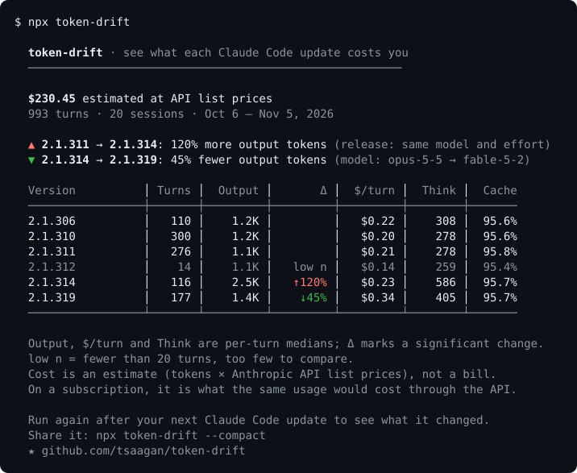

# driftcost

See what each Claude Code update costs you, from the logs already on your machine.

```
npx driftcost
```



Claude Code ships updates often, and now and then one of them changes how much it writes, thinks or costs. driftcost reads the session logs Claude Code already keeps and lines the numbers up by version, so you can see when something moved and what most likely moved it. There is nothing to configure. It reads local files only and makes no network requests.

The picture is a run on sample logs. In it, 2.1.314 started writing more than twice as much per turn, and the jump is still there when only turns on the same model and effort level are compared, so it is put down to the release. The drop at 2.1.319 lines up with a switch from Opus 5.5 to Fable 5.2, so the model is named instead.

## After an update

Run it again once you have used a new Claude Code version for a while. Until that version has 20 turns the output says how far along it is:

```
  · Latest, 2.1.320: 5 turns so far, 15 more to compare it with 2.1.319
```

After that it either gets a line of its own saying what changed and why, or one saying it hasn't moved.

## Options

```
--by-version, -v   Group by Claude Code version (default)
--by-model, -m     Group by model
--by-effort, -e    Group by effort level
--json             Print the report as JSON
--compact          Print a short summary instead of the table
--help, -h         Show this help
```

`--compact` prints at most three lines, for pasting into a chat:

```
driftcost · $230.45 estimated · 993 turns · Oct 6 – Nov 5, 2026
▼ 2.1.314 → 2.1.319: 45% fewer output tokens (model: opus-5-5 → fable-5-2)
▲ 2.1.311 → 2.1.314: 120% more output tokens (release: same model and effort)
```

## Reading the table

A turn is one prompt you typed plus everything Claude Code did in response, tool calls included.

| Column | What it is |
|--------|------------|
| Turns | Number of turns on that version |
| Output | Median output tokens per turn |
| Δ | Change in Output from the previous version, shown only when it is statistically significant |
| $/turn | Median estimated cost per turn |
| Think | Median thinking tokens per turn. A dash means the logs for that version don't record them |
| Cache | Share of cache tokens that were reads rather than writes. A dash means no cache was used |

Rows marked `low n` have fewer than 20 turns. They are listed but skipped when comparing, so each version is compared with the nearest earlier one that has enough data.

## What caused a change

When output tokens shift significantly between two versions, driftcost repeats the comparison using only turns that ran on the same model at the same effort level.

- `release`: the shift is still there like for like, so the model and effort can't explain it.
- `model`: there was no like-for-like shift, and the most-used model differs between the two versions.
- `effort`: same, but it is the effort level that differs.
- `cause unclear`: none of the above could be shown, usually because there were too few comparable turns.

## How cost is estimated

Each API request in the logs is priced at Anthropic's published list price for its model, with input, output, cache reads, 5-minute cache writes and 1-hour cache writes each at their own rate. The rate table is in [`src/stats/pricing.ts`](src/stats/pricing.ts). It covers Haiku 3.5 up to Opus 5.5 and Fable 5.2, including the higher Haiku 5.5 rate for prompts over 100K tokens.

The total is an estimate, not a bill. On a Claude subscription you aren't charged per token, so read it as what the same usage would cost through the API. Bedrock and Vertex prices, batch discounts and negotiated rates aren't modelled. Turns on a model the table doesn't know are still counted, but they are left out of the cost and the output says how many there were.

## How significance is decided

For each version, driftcost takes the median output tokens per turn and a 95% confidence interval for that median from order statistics: the values at ranks n/2 ± 0.98·√n of the sorted turns. A change is flagged only when the intervals of the two versions don't overlap. That is stricter than a plain test at the 5% level, which suits a tool whose worst failure is crying wolf.

## JSON

`--json` prints the full report. With no logs it still prints a valid, empty report, so a script piping it into `jq` won't break.

```json
{
  "schemaVersion": 1,
  "groupBy": "harnessVersion",
  "totals": {
    "estimatedCostUsd": 230.446994,
    "turns": 993,
    "sessions": 20,
    "unpricedTurns": 0,
    "firstSeen": "2026-10-06",
    "lastSeen": "2026-11-05"
  },
  "rows": [
    {
      "key": "2.1.314",
      "turns": 116,
      "sessions": 2,
      "lowSample": false,
      "medianOutputTokens": 2508,
      "outputTokensCi": [2315, 2772],
      "medianThinkingTokens": 585.5,
      "medianToolCalls": 3,
      "cacheHitRate": 0.957217,
      "estimatedCostUsd": 26.90564,
      "medianCostPerTurnUsd": 0.232073,
      "unpricedTurns": 0,
      "firstSeen": "2026-10-27",
      "lastSeen": "2026-10-28"
    }
  ],
  "changes": [
    {
      "from": "2.1.311",
      "to": "2.1.314",
      "outputTokensChange": 1.2,
      "costPerTurnChange": 0.093873,
      "significant": true,
      "attribution": {
        "cause": "release",
        "model": "claude-opus-5-5",
        "effort": "high",
        "turnsFrom": 276,
        "turnsTo": 116
      }
    }
  ]
}
```

`rows` and `changes` are shortened here to one entry each. `medianThinkingTokens`, `cacheHitRate` and `medianCostPerTurnUsd` are `null` when there is nothing to compute them from, and `attribution` is `null` for changes that aren't significant.

## Where it looks for logs

`~/.config/claude/projects` and `~/.claude/projects`. If `CLAUDE_CONFIG_DIR` is set, it reads `$CLAUDE_CONFIG_DIR/projects` instead.

## Limitations

- Only output tokens are tested for significance. Cost, thinking and cache figures are shown as they are.
- Subagent transcripts are skipped, so heavy subagent use is under-counted in both turns and cost.
- Turns from the same session are treated as independent, which makes the intervals somewhat narrower than they should be.
- Thinking tokens and effort level only appear in logs from newer Claude Code versions.
- Resumed sessions haven't been checked for double counting.

## Development

```
git clone https://github.com/tsaagan/token-drift.git
cd token-drift
npm install
npm run check    # type-check, tests, lint
```

## License

MIT
